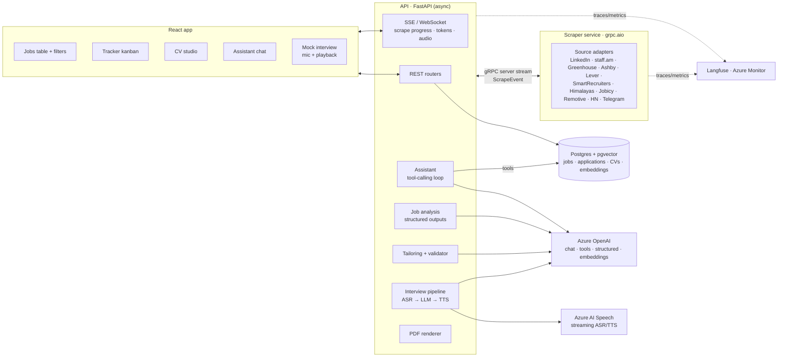
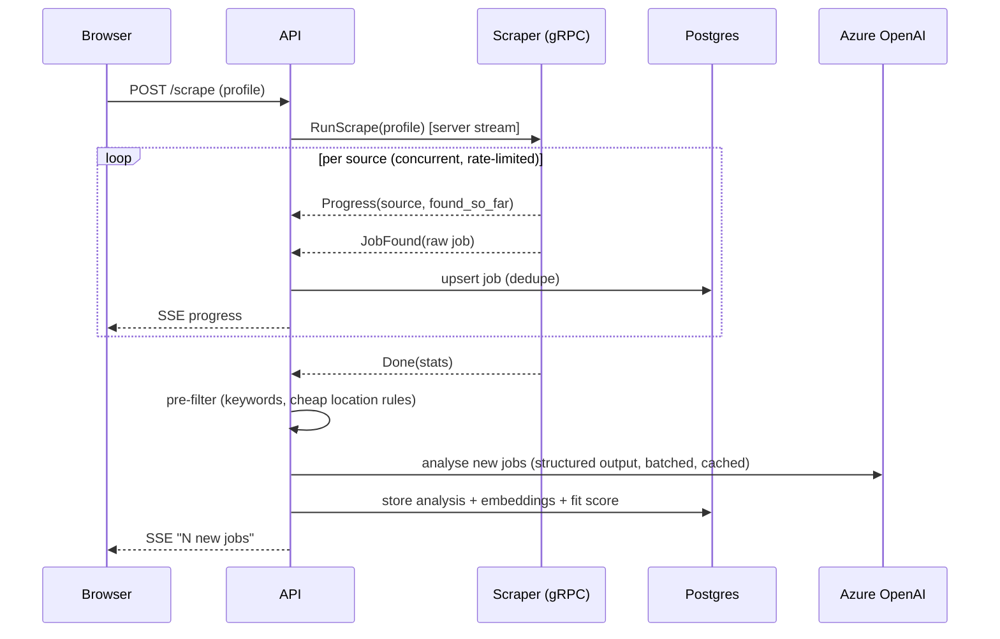
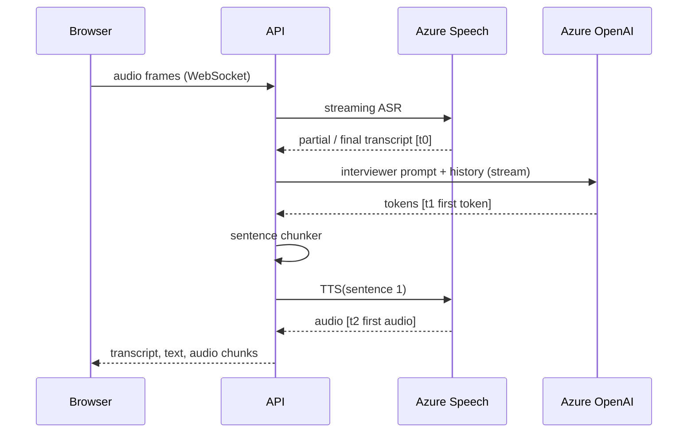

# Architecture

## Components



Until M3 the scraper adapters run inside the API process. Keep the boundary clean from day one: adapters yield `RawJob` objects and know nothing about the DB or HTTP routes, so moving them behind gRPC is a wiring change.

## Scrape run



## scraper.proto (starting point for M3)

```proto
syntax = "proto3";
package jobhunt.scraper.v1;

service Scraper {
  rpc RunScrape(ScrapeRequest) returns (stream ScrapeEvent);
}

message ScrapeRequest {
  string profile_id = 1;
  repeated string sources = 2;   // empty = all enabled in the profile
  int32 max_age_days = 3;
}

message ScrapeEvent {
  oneof payload {
    Progress progress = 1;
    RawJob job = 2;
    SourceError error = 3;
    Done done = 4;
  }
}

message Progress { string source = 1; int32 found = 2; }
message RawJob {
  string source = 1; string url = 2; string title = 3; string company = 4;
  string location = 5; bool remote = 6; string posted_at = 7;
  string description = 8; string salary = 9;
}
message SourceError { string source = 1; string message = 2; bool rate_limited = 3; }
message Done { int32 total = 1; int32 failed_sources = 2; int64 duration_ms = 3; }
```

## Data model (core)

```
profiles(id, name, settings jsonb)                       -- ported from profile.json
jobs(id, url unique, source, title, company, location, remote, posted_at,
     description, salary, content_hash, first_seen, last_seen)
job_analysis(job_id → jobs, model, prompt_version, data jsonb, created_at)
job_embeddings(job_id → jobs, embedding vector(1536))     -- HNSW cosine
applications(id, job_id, profile_id, status, notes, updated_at)
status_history(application_id, from_status, to_status, at, source)   -- source: user | assistant | inbox
cvs(id, profile_id, kind: master|tailored, job_id null, data jsonb, created_at)
cv_bullets(id, cv_id, job_index, bullet_index, text, embedding vector(1536))
cover_letters(id, job_id, profile_id, text, created_at)
```

## Tailoring validator (the honesty guarantee)

A tailored CV is accepted only if:

1. Every experience entry exists in the master with the same company, title and dates; none are dropped.
2. Every bullet maps to a master bullet of the same job: cosine similarity ≥ a threshold, **and** every number, product name and proper noun in the tailored bullet appears in the source bullet.
3. Every skill in the skills section appears somewhere in the master (skills list or tech stacks).
4. Certificates and education are unchanged.

Failures go back to the model with the specific violations (max 2 retries), then surface to the user. Unit tests inject fake skills, changed numbers and invented bullets.

## Mock interview turn (M8)



Track `t0`, `t1 − t0` and `t2 − t1`; the headline metric is **time to first audio**. Levers: stream everything, TTS per sentence, a short system prompt, a fast model, reused clients, and cancel on barge-in.

## Decisions to record as ADRs

1. gRPC between API and scraper (vs a task queue like Celery/Arq).
2. LLM structured outputs for job analysis vs the regex heuristics (keep regex as a pre-filter).
3. pgvector vs Azure AI Search.
4. Deterministic validator plus LLM rules for tailoring honesty.
5. Container Apps first, AKS later.
6. Multi-LLM routing policy.
